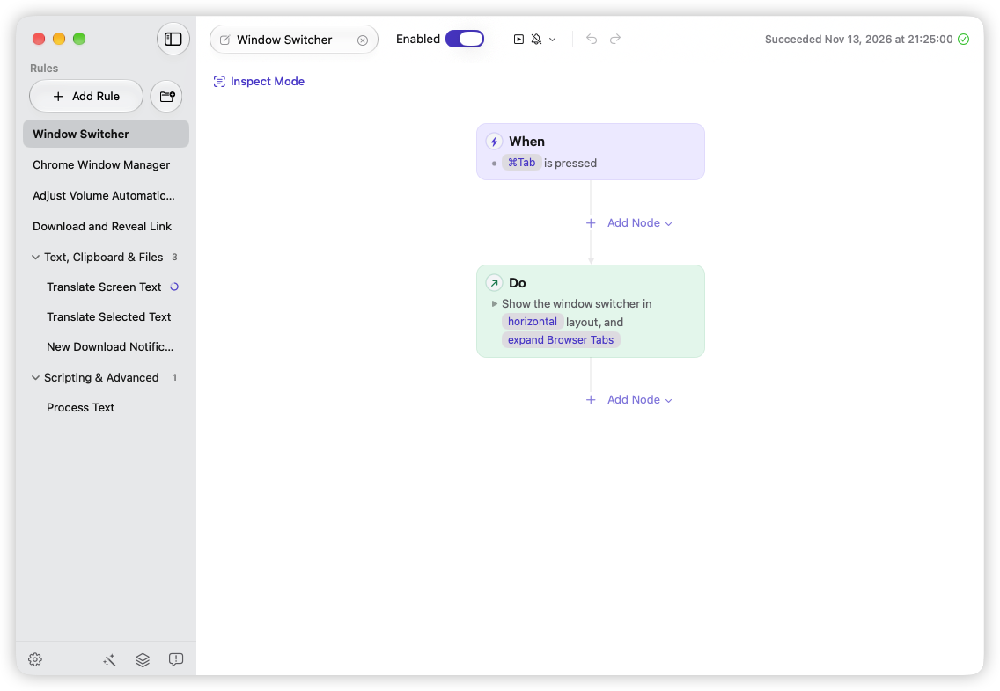

  

<h1 align="center">Rulr Rule Gallery</h1>

  <strong>Visual automation for your Mac.</strong> 
  Connect When, If, and Do to automate everyday tasks.

  <a href="https://www.rulr.app/">Website</a> ·
  <a href="https://www.rulr.app/rules/">Interactive gallery</a> ·
  <a href="https://www.rulr.app/posts/">Guides</a> ·
  <a href="https://www.rulr.app/download/Rulr.dmg">Download Rulr</a>

macOS 26+ · 100 official rules · MIT-licensed examples

  <a href="https://www.rulr.app/rules/mac-window-switcher/">
    <picture>
      <source media="(prefers-color-scheme: dark)" srcset="assets/rulr-rule-dark.png">
      
    </picture>
  </a>

## About Rulr

[Rulr](https://www.rulr.app/) is a Mac automation app for building visual Rules:
choose **when** a task starts, add **if** conditions when needed, and connect the
actions to **do**. Use Rules for apps, windows, files, text, browser tasks, and
system settings. You can build a Rule yourself or describe a task to the optional
AI Builder, then review and adjust the result.

This is the official collection of rule examples and setup guides. Each example
includes an importable `.rulr` file, configuration instructions, and a link to its
interactive preview on the website. The Rulr application is developed separately;
its source code is not included here.

## Get started

1. [Download Rulr](https://www.rulr.app/download/Rulr.dmg) for macOS 26 or later.
2. Choose a rule in the [directory below](#rule-directory). Open its website preview and select **Open in Rulr**, or download the `.rulr` file from its folder and open it with the app.
3. Review the rule, select your own apps, folders, devices, or shortcut where needed, and grant the required permissions before enabling it.

Some Triggers and Actions require Rulr Pro. Each rule's detail page explains its
setup and limitations. Importing the examples does not require an AI provider;
using AI Builder requires your own supported provider connection.

## Rule directory

100 rules, organized by their primary Gallery category. Open a rule's name
for its README and download, or choose **Preview and setup** for the website.

[Work & Productivity](#work-productivity) · [Study & Research](#study-research) · [Writing & Communication](#writing-communication) · [Daily Life & Personal](#daily-life-personal) · [Files & Organization](#files-organization) · [Web & Browsing](#web-browsing) · [Entertainment & Media](#entertainment-media)

### Work & Productivity

| Rule | What it does | Website |
| --- | --- | --- |
| [Click a Window Position](rules/click-window-position/) | Move the pointer and click a configured position when a matching window opens. | [Preview and setup](https://www.rulr.app/rules/click-window-position-mac/) |
| [Close Work Apps](rules/close-companion-apps/) | Close related tools when the main work app quits. | [Preview and setup](https://www.rulr.app/rules/quit-companion-apps-mac/) |
| [Focus Session](rules/focus-session/) | Prepare a distraction-free workspace and track one work block. | [Preview and setup](https://www.rulr.app/rules/focus-session-timer-mac/) |
| [Launch and Focus App](rules/open-app-with-hotkey/) | Launch an app and bring it forward from one shortcut. | [Preview and setup](https://www.rulr.app/rules/launch-app-keyboard-shortcut-mac/) |
| [Meeting Mode](rules/meeting-app-setup/) | Prepare notes, audio, and windows for meetings. | [Preview and setup](https://www.rulr.app/rules/meeting-mode-audio-mac/) |
| [Monitor Workspace](rules/setup-windows-for-monitor/) | Arrange a selected app window when an external monitor connects. | [Preview and setup](https://www.rulr.app/rules/arrange-windows-monitor-mac/) |
| [Move Window to Left Half](rules/snap-window-left/) | Move the focused window to the left half of its screen with a shortcut. | [Preview and setup](https://www.rulr.app/rules/snap-window-left-mac/) |
| [Office Work Mode](rules/start-work-office-wifi/) | Open tools for the current session after joining the office network. | [Preview and setup](https://www.rulr.app/rules/open-apps-wifi-mac/) |
| [Open Project Folder](rules/open-project-when-editor-starts/) | Open a selected project folder when its working app launches. | [Preview and setup](https://www.rulr.app/rules/open-project-folder-mac/) |
| [Open Work Apps](rules/open-work-apps/) | Open the right work apps automatically for each work session. | [Preview and setup](https://www.rulr.app/rules/open-work-apps-mac/) |
| [Present New Video Windows](rules/toggle-full-screen/) | Move newly created video-app windows to your presentation display and toggle full screen. | [Preview and setup](https://www.rulr.app/rules/full-screen-keyboard-shortcut-mac/) |
| [Press Keys When an App Launches](rules/press-keys-when-app-launches/) | Send a configured key sequence after a selected application launches. | [Preview and setup](https://www.rulr.app/rules/press-keys-app-launch-mac/) |
| [Process Text with AppleScript](rules/process-selected-text-shell-script/) | Process entered text with AppleScript and show the result. | [Preview and setup](https://www.rulr.app/rules/process-text-applescript-mac/) |
| [Quick Note](rules/quick-note/) | Capture a thought without leaving the current app. | [Preview and setup](https://www.rulr.app/rules/quick-note-text-file-mac/) |
| [Quit Open Apps](rules/quit-all-user-apps/) | Use a keyboard shortcut to review and quit open apps together, keeping Finder and Rulr open. | [Preview and setup](https://www.rulr.app/rules/quit-all-apps-mac/) |
| [Resume Work](rules/wait-for-internet-after-wake/) | Restore the appropriate workspace after wake. | [Preview and setup](https://www.rulr.app/rules/open-workspace-after-wake-mac/) |
| [Save Current Page](rules/save-current-page-reading-log/) | Add the active page to your work log. | [Preview and setup](https://www.rulr.app/rules/save-chrome-url-reading-log-mac/) |
| [Schedule AppleScript File](rules/run-chosen-applescript/) | Run your configured AppleScript file on a weekday schedule. | [Preview and setup](https://www.rulr.app/rules/run-scpt-file-mac/) |
| [Scroll an App Automatically](rules/scroll-app-automatically/) | Scroll a configured distance when a selected application becomes frontmost. | [Preview and setup](https://www.rulr.app/rules/scroll-app-automatically-mac/) |
| [Sort Project Files](rules/sort-project-files/) | Route new project files to the right folders. | [Preview and setup](https://www.rulr.app/rules/sort-project-files-by-type-mac/) |
| [Trim Text](rules/trim-text/) | Clean up entered text and copy it for pasting anywhere. | [Preview and setup](https://www.rulr.app/rules/trim-copy-text-mac/) |
| [Window Switcher](rules/window-switcher/) | Switch between open Mac windows with a visual picker. | [Preview and setup](https://www.rulr.app/rules/mac-window-switcher/) |

### Study & Research

| Rule | What it does | Website |
| --- | --- | --- |
| [Capture Image](rules/save-study-image/) | Capture an image, convert it to PNG, and save it to a folder. | [Preview and setup](https://www.rulr.app/rules/capture-screen-png-typed-trigger-mac/) |
| [Capture Reading Pages](rules/reading-page-log/) | Append each Chrome page you focus to a reading log. | [Preview and setup](https://www.rulr.app/rules/log-chrome-url-window-title-changes-mac/) |
| [Citation Capture](rules/citation-capture/) | Save the current page, URL, and selected quote as a citation. | [Preview and setup](https://www.rulr.app/rules/save-chrome-citation-quote-mac/) |
| [Copy Text from Your Screen](rules/copy-screen-text/) | Recognize and copy text from anywhere on your Mac screen. | [Preview and setup](https://www.rulr.app/rules/copy-text-mac-screen/) |
| [Find Quartiles Word Candidates](rules/quartiles-word-candidates/) | Find local dictionary word candidates from 20 Quartiles tiles and open a report. | [Preview and setup](https://www.rulr.app/rules/quartiles-word-candidates-mac/) |
| [Focus Session](rules/study-session/) | Open a workspace, run a focused timer, and signal completion. | [Preview and setup](https://www.rulr.app/rules/schedule-study-session-mac/) |
| [Letters and Alphabet Positions](rules/letters-and-positions/) | Convert English letters to alphabet positions, or positions back to letters. | [Preview and setup](https://www.rulr.app/rules/letters-to-numbers-mac/) |
| [Open Research Drive](rules/research-drive-ready/) | Open your research folder when its drive becomes available. | [Preview and setup](https://www.rulr.app/rules/open-folder-when-drive-mounts-mac/) |
| [Read an Article Hands-Free](rules/repeat-spacebar-reading/) | Advance a chosen Safari article by one screen every 30 seconds while reading. | [Preview and setup](https://www.rulr.app/rules/auto-press-spacebar-mac/) |
| [Read, Translate, and Save](rules/read-translate-save/) | Read a file, translate it, and save the result. | [Preview and setup](https://www.rulr.app/rules/translate-text-file-schedule-mac/) |
| [Recognize Screen Text](rules/ocr-selected-screen/) | Turn text on screen into copyable text. | [Preview and setup](https://www.rulr.app/rules/recognize-screen-text-mac/) |
| [Research Capture](rules/research-capture/) | Trim copied research text and append it to your notes. | [Preview and setup](https://www.rulr.app/rules/save-clipboard-research-notes-mac/) |
| [Review Reminder](rules/study-reminder/) | Remind you to review your notes at a regular interval. | [Preview and setup](https://www.rulr.app/rules/repeat-study-reminder-mac/) |
| [Save Screen Capture](rules/capture-screen-evidence/) | Capture the screen and save it where you need it. | [Preview and setup](https://www.rulr.app/rules/save-screen-capture-folder-mac/) |
| [Speak Selected Text](rules/speak-selected-text/) | Hear selected text read aloud. | [Preview and setup](https://www.rulr.app/rules/read-selected-text-aloud-mac/) |
| [Transform and Archive Notes](rules/transform-and-archive-notes/) | Normalize new research notes, save them, and move them to an archive. | [Preview and setup](https://www.rulr.app/rules/normalize-archive-new-text-files-mac/) |
| [Translate and Copy](rules/translate-and-copy-selection/) | Translate selected text and place the result on the clipboard. | [Preview and setup](https://www.rulr.app/rules/translate-selected-text-copy-mac/) |
| [Translate Screen Text](rules/translate-screenshot/) | Capture, recognize, and translate text anywhere on your Mac screen. | [Preview and setup](https://www.rulr.app/rules/translate-screen-text-mac/) |

### Writing & Communication

| Rule | What it does | Website |
| --- | --- | --- |
| [Extract Line-End Number](rules/replace-text-newlines/) | Show a line-end number automatically when matching report text is copied. | [Preview and setup](https://www.rulr.app/rules/remove-line-breaks-regex-mac/) |
| [Paste as Plain Text](rules/insert-plain-text/) | Paste clipboard text without source formatting into the frontmost app with Option + V. | [Preview and setup](https://www.rulr.app/rules/paste-without-formatting-mac/) |
| [Paste URL-Encoded Text](rules/paste-as-plain-text/) | URL-encode clipboard text and paste the result into the frontmost app with one keyboard shortcut. | [Preview and setup](https://www.rulr.app/rules/url-encode-paste-text-mac/) |
| [Remove Emoji from Text](rules/remove-emoji-text/) | Automatically remove common emoji sequences when matching text is copied. | [Preview and setup](https://www.rulr.app/rules/remove-emojis-from-text-mac/) |
| [Save Selected Text](rules/save-selected-text/) | Append selected text to a notes file from any supported app. | [Preview and setup](https://www.rulr.app/rules/save-selected-text-mac/) |
| [Switch Input Method](rules/switch-input-method-by-app/) | Switch to a selected input method when an app becomes active. | [Preview and setup](https://www.rulr.app/rules/switch-input-method-by-app-mac/) |
| [Text Expansion](rules/text-expansion/) | Expand a short typed trigger into reusable text. | [Preview and setup](https://www.rulr.app/rules/text-expansion-mac/) |
| [Translate Clipboard](rules/translate-clipboard/) | Translate copied text and show the result. | [Preview and setup](https://www.rulr.app/rules/translate-clipboard-mac/) |
| [Translate Selected Text](rules/translate-selected-text/) | Translate selected text on your Mac and show the result. | [Preview and setup](https://www.rulr.app/rules/translate-selected-text-mac/) |
| [Uppercase Selected Text](rules/uppercase-selected-text/) | Convert selected text to uppercase and replace it. | [Preview and setup](https://www.rulr.app/rules/uppercase-selected-text-mac/) |

### Daily Life & Personal

| Rule | What it does | Website |
| --- | --- | --- |
| [Clear Clipboard When Away](rules/clear-current-clipboard/) | Replace the clipboard with an innocuous marker after five minutes of system inactivity. | [Preview and setup](https://www.rulr.app/rules/clear-clipboard-mac/) |
| [Confirm Before Shutdown](rules/safe-shutdown-hotkey/) | Prevent accidental shutdowns with confirmation. | [Preview and setup](https://www.rulr.app/rules/confirm-shutdown-keyboard-shortcut-mac/) |
| [Launch App](rules/launch-app-if-needed/) | Launch an app or bring it forward if already open. | [Preview and setup](https://www.rulr.app/rules/launch-app-with-shortcut-mac/) |
| [Low Battery Alert](rules/low-battery-warning/) | Get warned when the battery reaches a low level. | [Preview and setup](https://www.rulr.app/rules/low-battery-alert-mac/) |
| [Morning Work Setup](rules/weekday-morning-setup/) | Open your work tools on weekday mornings. | [Preview and setup](https://www.rulr.app/rules/launch-apps-at-time-mac/) |
| [Mute and Close Apps When Idle](rules/mute-and-close-private-apps-when-idle/) | Mute audio and close private apps automatically when your Mac is idle. | [Preview and setup](https://www.rulr.app/rules/mute-close-apps-mac-idle/) |
| [Offline Alert](rules/warn-when-offline/) | Get an audible warning when the Mac goes offline. | [Preview and setup](https://www.rulr.app/rules/network-disconnection-alert-mac/) |
| [Quit an App on a Schedule](rules/quit-app-on-schedule/) | Quit a selected Mac app automatically at a scheduled time. | [Preview and setup](https://www.rulr.app/rules/quit-app-on-schedule-mac/) |
| [Recover a Stuck App](rules/open-force-quit/) | Confirm, force quit and reopen the frontmost app when it stops responding. | [Preview and setup](https://www.rulr.app/rules/force-quit-shortcut-mac/) |
| [Run Shortcut for USB Device](rules/run-shortcut-when-device-connects/) | Run a selected Apple Shortcut when a matching USB device connects. | [Preview and setup](https://www.rulr.app/rules/run-shortcut-usb-device-mac/) |
| [Sync App Appearance](rules/sync-app-appearance/) | Keep another app aligned with system appearance. | [Preview and setup](https://www.rulr.app/rules/run-applescript-appearance-change-mac/) |
| [Toggle App Visibility](rules/toggle-app-visibility/) | Show or hide a selected application with the same shortcut. | [Preview and setup](https://www.rulr.app/rules/toggle-app-visibility-mac/) |
| [Turn On Dark Mode with a Shortcut](rules/turn-on-dark-mode-with-shortcut/) | Switch your Mac to Dark appearance with a keyboard shortcut. | [Preview and setup](https://www.rulr.app/rules/mac-dark-mode-keyboard-shortcut/) |
| [USB App Launcher](rules/open-app-for-usb-device/) | Open the right app when a USB device connects. | [Preview and setup](https://www.rulr.app/rules/open-app-usb-device-mac/) |
| [USB Device Alert](rules/usb-device-arrival-alert/) | Get notified when a USB device connects. | [Preview and setup](https://www.rulr.app/rules/usb-device-connection-alert-mac/) |

### Files & Organization

| Rule | What it does | Website |
| --- | --- | --- |
| [Archive Screenshots](rules/archive-new-screenshots/) | Keep new screenshots organized in an archive. | [Preview and setup](https://www.rulr.app/rules/archive-screenshots-mac/) |
| [Batch Prefix Files](rules/batch-prefix-files/) | Preview or add a prefix to matching files in a folder on a schedule. | [Preview and setup](https://www.rulr.app/rules/batch-rename-files-mac/) |
| [Capture and Name Screenshot](rules/capture-named-screenshot/) | Capture a region, ask for a filename and save the named PNG in your chosen folder. | [Preview and setup](https://www.rulr.app/rules/screenshot-macro-mac/) |
| [Extract Text from New Images](rules/ocr-new-downloaded-image/) | Extract text from new images added to a watched folder. | [Preview and setup](https://www.rulr.app/rules/extract-text-images-mac/) |
| [Group Selected Files](rules/new-finder-folder/) | Put selected Finder items into a new folder whose name you choose. | [Preview and setup](https://www.rulr.app/rules/new-folder-hotkey-mac/) |
| [Keep Current Finder Window](rules/close-finder-windows/) | Close other Finder windows while leaving the current one open. | [Preview and setup](https://www.rulr.app/rules/close-all-finder-windows-mac/) |
| [Open New Files](rules/open-new-files/) | Open files when they are added to a watched folder. | [Preview and setup](https://www.rulr.app/rules/open-new-files-mac/) |
| [Organize Downloaded Images](rules/organize-downloaded-images/) | Sort new image downloads automatically. | [Preview and setup](https://www.rulr.app/rules/move-new-image-files-mac/) |
| [Organize Downloaded PDFs](rules/organize-downloaded-pdfs/) | Sort new PDF downloads automatically. | [Preview and setup](https://www.rulr.app/rules/organize-downloaded-pdfs-mac/) |
| [Organize New Downloads](rules/organize-new-downloads/) | Move new downloads into the right folder. | [Preview and setup](https://www.rulr.app/rules/move-new-files-to-folder-mac/) |
| [Process New Files](rules/process-new-files-shell-script/) | Send new watched files through a shell script. | [Preview and setup](https://www.rulr.app/rules/run-shell-script-new-file-mac/) |
| [Project Backup](rules/back-up-new-files/) | Back up matching project downloads to a separate folder. | [Preview and setup](https://www.rulr.app/rules/copy-new-files-backup-mac/) |
| [Project Drive](rules/open-mounted-project-drive/) | Open a project drive when it becomes available. | [Preview and setup](https://www.rulr.app/rules/open-mounted-drive-mac/) |
| [Rename New Files](rules/rename-new-files/) | Apply a consistent name to new watched files. | [Preview and setup](https://www.rulr.app/rules/rename-new-files-mac/) |
| [Reveal Renamed Files](rules/reveal-renamed-files/) | Find renamed files in Finder immediately. | [Preview and setup](https://www.rulr.app/rules/reveal-new-files-in-finder-mac/) |
| [Run Shortcut for Folder](rules/run-shortcut-when-folder-changes/) | Run a Shortcut when watched folder contents change. | [Preview and setup](https://www.rulr.app/rules/watch-folder-run-shortcut-mac/) |
| [Sort Downloads](rules/smart-download-router/) | Route images, PDFs, and archives from Downloads into the right folders. | [Preview and setup](https://www.rulr.app/rules/sort-downloads-mac/) |

### Web & Browsing

| Rule | What it does | Website |
| --- | --- | --- |
| [Chrome Research Workspace](rules/browser-research-flow/) | Open the right Chrome research workspace for each work session. | [Preview and setup](https://www.rulr.app/rules/chrome-research-workspace/) |
| [Chrome Window Manager](rules/search-browser-windows-tabs/) | Search and switch between open Chrome windows and tabs. | [Preview and setup](https://www.rulr.app/rules/search-chrome-windows-tabs/) |
| [Copy Current Chrome URL](rules/copy-current-browser-url/) | Copy the active Chrome tab URL to the clipboard. | [Preview and setup](https://www.rulr.app/rules/copy-current-chrome-url-mac/) |
| [Copy Page as Markdown Link](rules/copy-page-as-markdown-link/) | Copy the current Chrome page title and URL as a Markdown link. | [Preview and setup](https://www.rulr.app/rules/copy-page-markdown-link-mac/) |
| [Download and Reveal a Link](rules/download-selected-link/) | Download a selected link and reveal the saved file in Finder. | [Preview and setup](https://www.rulr.app/rules/download-selected-link-mac/) |
| [Encode Selected Text](rules/url-encode-selected-text/) | Prepare selected text for use in a URL. | [Preview and setup](https://www.rulr.app/rules/url-encode-selected-text-mac/) |
| [Open Clipboard Link](rules/open-clipboard-link/) | Review a copied web link and open it in Safari without pasting into the address bar. | [Preview and setup](https://www.rulr.app/rules/open-clipboard-link-mac/) |
| [Restore Work Tabs](rules/restore-browser-work-tabs/) | Reopen your usual browser workspace. | [Preview and setup](https://www.rulr.app/rules/open-chrome-work-tabs-mac/) |
| [Run Tab JavaScript](rules/run-javascript-current-tab/) | Run JavaScript in the active browser tab and view the result. | [Preview and setup](https://www.rulr.app/rules/run-javascript-chrome-tab-mac/) |
| [Search Selected Text](rules/search-selected-text/) | Search the web using text selected in any supported Mac app. | [Preview and setup](https://www.rulr.app/rules/search-selected-text-mac/) |
| [Show Current Tab](rules/show-current-chrome-tab/) | View the active browser tab's URL. | [Preview and setup](https://www.rulr.app/rules/show-current-chrome-url-mac/) |

### Entertainment & Media

| Rule | What it does | Website |
| --- | --- | --- |
| [Import Media](rules/media-import-pipeline/) | Sort new images and videos into separate media folders. | [Preview and setup](https://www.rulr.app/rules/sort-photos-videos-mac/) |
| [Media Manager](rules/media-manager/) | Open a panel of detected media sources and play or pause eligible players. | [Preview and setup](https://www.rulr.app/rules/control-media-playback-mac/) |
| [Microphone Change Alert](rules/show-microphone-change/) | See when the default microphone changes. | [Preview and setup](https://www.rulr.app/rules/microphone-change-alert-mac/) |
| [Mute Disconnected Headphones](rules/mute-headphones-disconnect/) | Mute audio when your headset disconnects. | [Preview and setup](https://www.rulr.app/rules/audio-on-headphones-disconnect-mac/) |
| [Set Up Headset Audio](rules/bluetooth-headset-routing/) | Switch audio output and set its volume. | [Preview and setup](https://www.rulr.app/rules/switch-audio-when-bluetooth-connects-mac/) |
| [Set Volume by Audio Device](rules/set-headphone-volume/) | Set volume by audio device and open your music app when needed. | [Preview and setup](https://www.rulr.app/rules/set-volume-audio-device-mac/) |
| [Switch Audio Output](rules/switch-audio-output/) | Switch Mac audio to a selected speaker or pair of headphones. | [Preview and setup](https://www.rulr.app/rules/switch-audio-output-mac/) |

## Updates and contributions

The website is the source of truth for rule configurations and setup text. This repository mirrors the published catalog daily and supports manual synchronization. It uses only public website URLs, without access to the private website or app repositories.

If you find a problem or want another rule, [open an issue](https://github.com/snowfallapps/rulr-rules/issues). Include the rule name, macOS and Rulr versions, expected result, and what happened. Remove private text, file paths, device identifiers, and credentials before sharing a custom rule.

Pull requests with fixes or new examples are welcome. Mirrored files may be replaced by synchronization, so rule and documentation changes must also be incorporated into the website source. See [CONTRIBUTING.md](CONTRIBUTING.md).

## License

The examples, documentation, and sync script in this repository are available under the [MIT License](LICENSE). This does not license the Rulr app or its trademarks.
